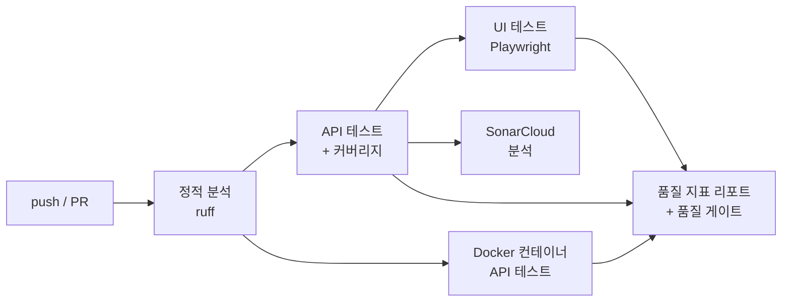

# Cloud QA Automation


> 클라우드 콘솔의 **인스턴스 관리**와 **요금 계산** 기능을 대상으로 테스트를 설계하고,
> **API·UI 테스트 자동화 → Docker 환경 검증 → 품질 지표 리포트**까지 CI 파이프라인으로 구성한 QA 자동화 프로젝트

<br>

## 핵심 결과

| 항목 | 결과 |
|---|---|
| 자동화 테스트 | **45개** (API 35 · UI 10) |
| 통과율 | **100%** (품질 게이트: 100% 미만이면 CI 실패) |
| 코드 커버리지 | **98.9%** (품질 게이트: 90%) |
| 실행 환경 | 로컬 프로세스 / **Docker 컨테이너** 양쪽에서 동일 테스트 통과 |
| 발견한 결함 | CI에서 **race condition 1건** 발견 및 해결 ([트러블슈팅](#트러블슈팅)) |
| 결함 검출력 검증 | 요금 올림 로직을 일부러 깨뜨렸을 때 경계값 테스트가 즉시 실패하는 것 확인 |

<br>

## CI 파이프라인



| 단계 | 내용 |
|---|---|
| 정적 분석 | ruff로 버그 가능성(B)·보안(S)·문법(E/F/UP) 검사 |
| API 테스트 | pytest + httpx, 커버리지 측정, JUnit/HTML 리포트 |
| Docker 테스트 | `docker compose`로 서비스를 컨테이너로 띄우고 같은 API 테스트를 외부에서 실행 |
| UI 테스트 | Playwright로 실제 브라우저 조작, 실패 시 스크린샷·trace 저장 |
| 품질 리포트 | JUnit·커버리지 결과를 모아 통과율·실행 시간·느린 테스트 Top 5·커버리지를 Actions Summary에 표시 |
| 품질 게이트 | 통과율 100% 미만 또는 커버리지 90% 미만이면 파이프라인 실패 |

<br>

## 테스트 설계

### 1. 요금 계산 — 경계값 분석
규칙: 월 무료 10시간 · 초과분 1시간 단위 올림 과금 · 허용 범위 0~744시간

| 입력(시간) | 기대 과금 시간 | 설계 의도 |
|---|---|---|
| 0 | 0 | 최소값 |
| 10 | 0 | 무료 구간 경계 |
| **10.1** | **1** | 무료 초과 직후 올림 처리 |
| 744 | 734 | 최대값 |
| -1, 744.1 | 422 오류 | 허용 범위 밖 |

### 2. 인스턴스 이름 — 동등 분할 + 경계값
| 구분 | 입력 | 기대 |
|---|---|---|
| 유효 | 1자, 32자, 소문자·숫자·하이픈 | 201 생성 |
| 무효 | 빈 문자열, 33자, 대문자, 언더스코어, 한글 | 422 거부 |

### 3. 상태 전이
`RUNNING → stop → STOPPED → start → RUNNING`
같은 상태로의 전이는 409, 지원하지 않는 동작은 400

### 4. UI 사용자 흐름
생성 → 목록 표시 · 입력 오류 메시지 · 중복 이름 오류 · 정지/시작 토글 · 삭제 · 요금 계산기 결과/오류

<br>

## 트러블슈팅

### CI에서만 실패하는 UI 테스트 — race condition
| | |
|---|---|
| **증상** | 로컬에서는 통과했지만 CI에서 `test_duplicate_name_shows_error`가 실패. 중복 이름 오류(409) 대신 이름 형식 오류(422)가 표시됨 |
| **원인** | 첫 번째 생성 요청의 응답이 오기 전에 두 번째 이름을 입력 → 뒤늦게 도착한 첫 응답이 입력칸을 비움 → 두 번째 요청에 빈 이름이 전송됨 |
| **로컬에서 통과한 이유** | 로컬은 응답이 빨라 타이밍이 우연히 맞았음 |
| **해결** | 첫 인스턴스가 목록에 나타난 것을 확인한 뒤 두 번째 생성을 수행하도록 대기 조건 추가 |
| **배운 점** | 환경에 따라 결과가 달라지는 테스트는 "통과했다"보다 "왜 통과했는지"를 확인해야 함 |

<br>

## 프로젝트 구조

```
app/                      테스트 대상: Mini Cloud Console (FastAPI)
  main.py                 인스턴스 API, 요금 계산 API
  console.html            웹 콘솔 화면
tests/
  conftest.py             서버 기동(로컬/BASE_URL), 테스트 간 상태 초기화
  api/                    API 테스트 (인스턴스, 요금 계산)
  ui/                     UI 테스트 (Playwright)
scripts/quality_report.py 품질 지표 계산 + 품질 게이트
Dockerfile                테스트 대상 컨테이너 이미지
docker-compose.yml
.github/workflows/        CI 파이프라인
```

<br>

## 실행 방법

```bash
pip install -r requirements.txt
python -m playwright install chromium

pytest -m api                      # API 테스트
pytest -m ui                       # UI 테스트
pytest --cov=app                   # 커버리지 포함 전체 실행

# Docker 컨테이너를 대상으로 테스트
docker compose up -d --build --wait
BASE_URL=http://localhost:8000 pytest -m api
docker compose down
```

<details>
<summary>SonarCloud 연동 방법</summary>

1. [sonarcloud.io](https://sonarcloud.io)에 GitHub 계정으로 로그인 후 이 저장소를 Import
2. Analysis Method에서 **Automatic Analysis 끄기** → GitHub Actions 선택
3. 발급된 토큰을 저장소 Settings → Secrets → Actions에 `SONAR_TOKEN`으로 등록

토큰이 없으면 CI의 SonarCloud 단계는 자동으로 건너뜁니다.
</details>
